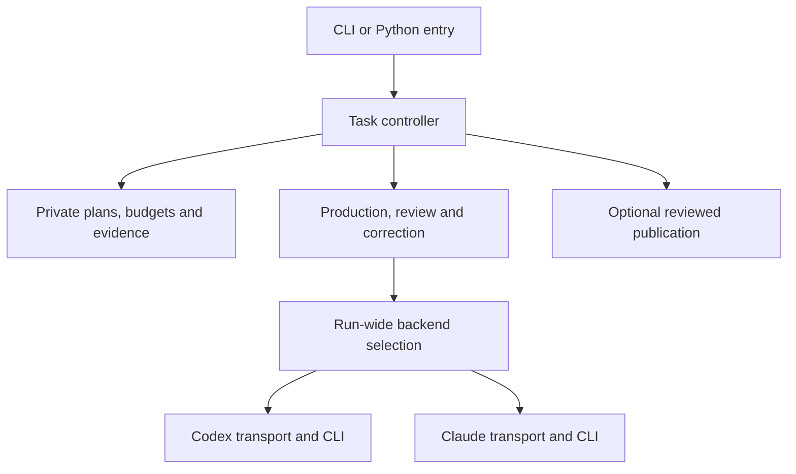
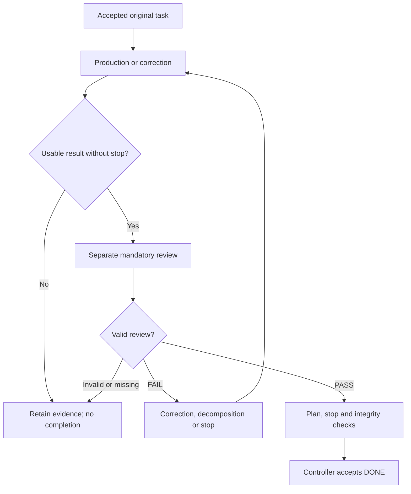

# ARQUILO Technical / Architecture Guide

**English · runtime 0.9.1 · integration checkout 2026-10-25**
[Documentation index](../README.md) · [Operator Guide](operator-guide.en.md) · [Architecture summary](#system)

> **Unreleased integration checkout, not the published v0.9.1 ZIP.** The version string remains 0.9.1. This edition combines the consolidated manuals/Git work from PR #37 with the current main runtime, including Claude Code and state-I/O repairs, and separates task acceptance from optional publication. See [source commits and remaining limits](../integration-status.md). An existing release ZIP does not acquire these changes automatically.

This guide explains the implementation and its trust boundaries for developers and technically advanced integrators. The integration combines the PR #37 handbook/Git baseline with main commit `cded22f337a0033a3b0934709a82e1ce3db7cdb3`, including Claude Code and state-I/O repairs, plus the local publication-separation changes. These source inputs identify provenance, not a completed final-commit acceptance. The version string remains 0.9.1; this does not replace the published ZIP.

## Contents

[System boundary](#system) · [Module map](#modules) · [Task lifecycle](#lifecycle) · [Review authority](#review) · [Plan persistence](#persistence) · [Filesystem and identity](#filesystem) · [Budgets](#budgets) · [Worker protocol](#workers) · [Transport and cancellation](#transport) · [Resources and prompts](#resources) · [Git](#git) · [Evidence](#evidence) · [Interfaces](#interfaces) · [Testing](#testing) · [Extension rules](#extensions)

<a id="system"></a>
## 1. System boundary and architectural intent

ARQUILO is a synchronous Python controller around a selected external agent CLI: Codex by default or Claude Code for the entire run. The runtime uses the Python standard library. The controller is neither a model server nor an OS sandbox; native authentication, provider routing and tools remain responsibilities of the selected runtime and host.



The producer's workspace is mutable. The controller must not accept model-edited status or public summaries as new authority merely because their format looks plausible. Captured original requirements, mandatory review and deterministic acceptance checks exist to separate proposed work from authorized completion.

An external state directory is a logical trust boundary only when actual host permissions and execution confinement keep workers from writing it. “Outside the workspace” does not defeat another hostile process with the same operating-system credentials. Native runtime integrations and configured permissions remain relevant. The [security model](../../SECURITY.md) must be read alongside this guide.

<a id="modules"></a>
## 2. Module ownership

| Responsibility | Principal implementation | What to inspect there |
| --- | --- | --- |
| Public command routing | [arquilo.py](../../arquilo.py) | Dispatch of tasklist, doctor, capabilities, package and compatibility aliases. |
| Task-list orchestration | [run_todos.py](../../run_todos.py) | Selection, scope, WAIT/STOP, child scheduling, parent acceptance, worker collection and final state changes. |
| Task grammar/context | `todo_syntax.py`, `todo_lint.py`, `todo_context.py`, `todo_ids.py`, `todo_template.py` | Visible task headers, directives, original preamble, IDs and no-overwrite initialization. |
| Task execution loop | [autobuild.py](../../autobuild.py) | Production, review, corrections, decisions and summary generation. |
| Call/result boundary | [autobuild_contract.py](../../autobuild_contract.py), `runtime_contracts.py`, `runtime_failure.py` | Validated options/context, serialized worker calls, consistent results and failure precedence. |
| Review semantics | [review_contract.py](../../review_contract.py), `review_confidence.py`, `review_resume.py` | Parser-owned provenance, blockers, advisory confidence and narrow archived-production recovery. |
| Plan authority/identity | [controller_state.py](../../controller_state.py) | Persistent accepted text, lock ownership, approved status transitions, identity and alias refusal. |
| Invocation accounting | [execution_budget.py](../../execution_budget.py) | Monotonic reservations, shared root counters and owner limit changes. |
| Safe local I/O | [safe_io.py](../../safe_io.py), `runtime_files.py` | Anchored/leased traversal, link/type checks, atomic creation/replacement and path validation. |
| Backend selection/evidence | `agent_backend.py`, `agent_types.py` | Explicit run-wide backend, backend-specific model defaults and shared evidence types without provider imports. |
| Claude boundary | `claude_transport.py`, `claude_launcher.py`, `agent_process.py`, `claude_decision.py`, `claude_doctor.py` | Native Claude stream-json, owned process I/O, structured decisions and metadata checks without Codex dispatch. |
| Host process selection | [host_launcher.py](../../host_launcher.py), `codex_launcher.py`, `claude_launcher.py`, `codex_policy.py` | Trusted external executables, sanitized PATH, native/npm launch forms and policy construction. |
| Process transport | [codex_transport.py](../../codex_transport.py), `process_tree.py` | Byte streams, event collection, terminal conditions, cancellation and cleanup. |
| Restricted decisions | `decide.py`, `decision_request.py`, `decision_exec.py`, `decision_response.py`, `decision_archive.py` | Input/context capture, constrained options, execution policy, response validation and archives. |
| Resources/configuration | [task_resources.py](../../task_resources.py), `mcp_selection.py`, `runtime_config.py`, `runtime_profile.py`, `prompt_config.py` | Operator ceilings, skill snapshots, native MCP overrides, profiles and immutable prompt catalogs. |
| Logs and publication | [project_logs.py](../../project_logs.py), `runtime_logging.py`, [reviewed_git.py](../../reviewed_git.py), [git_snapshot.py](../../git_snapshot.py) | Readable log namespace, run/attempt records and explicitly selected Git outputs. |
| Packaging | `scripts/stage_lean.py`, `scripts/check_release.py`, `scripts/build_runtime_zip.py` | Allowlisted runtime distribution, license/version/link checks and reproducible ZIP generation. |

Several modules retain dictionaries and compatibility structures alongside immutable dataclasses. Do not assume every internal object is an immutable, complete authority record. Consult the validator at each boundary.

<a id="lifecycle"></a>
## 3. Trace a task through the runtime

### Setup and selection

The CLI delegates to the existing runner rather than reinterpreting run options. The runner resolves paths, parses and validates the current plan, applies operator choices and prepares controller state. Template initialization is an explicit earlier preparation step; dry-run can create a working list and preview while avoiding model execution and controller-state creation.

The runner checks physical stop state before executable preflights. Profile preflight is trusted host code; the Codex workspace-write probe is separate and can be a model operation. An existing stop prevents a new probe. Whole-plan validation prevents later malformed directives from being silently ignored until a task is reached.

Selection honors the owner's `--start`/`--stop` range. A Markdown STOP barrier is considered before status/depth filtering within that range, so a DONE or too-deep task cannot hide a barrier from later work. WAIT evaluates defined dependency state; it is not an independent background scheduler.

### Capture, execute and review

The controller captures the original task and effective context before granting the producer access to mutable files. The task/preamble evidence used for copied worker requests must match that accepted source. AutoBuild executes production under the selected workspace-write policy, then performs a separate read-only review against the captured original request.



This is a conceptual flow, not a list of literal persisted status names. A successfully executed reviewer can legitimately reject its subject. Separate this from a reviewer process failure. A fixed artifact must receive another review; a previous pass is not reusable authorization for arbitrary new content.

### Decomposition and final acceptance

When the supported policy calls for decomposition, the controller validates insertion of open direct children and preserves the parent contract. Children share their numeric root's budget. Once required children are DONE, parent acceptance remains a separate review against the original request. OBSOLETE is not interchangeable with completed work.

Before recording completion, the runner checks stop state, the validated execution/review result and the current accepted plan revision. When a publication candidate was captured, its binding and selected bytes must remain valid at acceptance. Capture unavailability recorded before review can leave publication blocked while ordinary review still accepts the task. A late stop cannot turn into success through delayed collection of a completed worker. Only the authorized task command token may change for an ordinary DONE transition. Artifacts and diagnostics may exist even when final acceptance fails.

<a id="review"></a>
## 4. Review authority and result validation

`review_contract.py` owns detection of the actual incoming review format. A JSON object cannot declare itself legacy prose to select a weaker completion path. Normalized stored classifications have separate compatibility handling; callers should not confuse them with raw reviewer output.

The deterministic veto is simple: an explicit FAIL or blocking issue cannot be converted into COMPLETE by a later semantic decision. Legacy prose still requires its supported explicit Decide step, but that step is not allowed to override a blocker. Present raw findings cannot contradict a supposedly successful normalized result.

`autobuild_contract.validate_result()` checks boolean/integer types, exit/status/completed consistency, review requirements, matching error payloads, stop metadata, budget snapshots and successful completion evidence. At the Python-worker boundary it also compares the process exit with the reported result. Malformed results become technical failures; they are not repaired into success from their final prose.

`runtime_contracts.py` provides typed execution, review and decision results. A valid review FAIL means the review operation succeeded technically but its subject is unacceptable. Confidence fields are advisory: they do not change the verdict rule and are not calibrated probabilities.

These controls prevent contradictory acceptance, not all false model judgments. A plausible but mistaken PASS can still be wrong. Where artifacts permit deterministic checks, add those checks and independently validate the test's meaning. The [review reference](../../documents/REVIEW_CORE.md) is the detailed response contract.

<a id="persistence"></a>
## 5. Plan persistence, restart and owner overrides

`PlanAuthority` holds accepted plan text in a private `plan.json` with a plan-specific lock. At first use, existing owner-supplied statuses establish a baseline; initial DONE is not proof of a past ARQUILO review. Subsequent strict runs compare the live list with persistent accepted text and refuse unauthorized requirement/status/deletion/reordering changes.

An approved transition records its pending target, writes the authorized plan bytes and finalizes the journal. On restart, recovery is limited to the recorded before/after states. A third unrelated value is rejected rather than silently adopted. Completion is based on the accepted snapshot, not on an unchecked reread that can import another writer's DONE status.

Child adoption likewise persists the exact bytes that passed validation. Original contracts are captured from accepted task evidence. These mechanisms do not create a general transaction across the entire filesystem or make all recovery corruption cases solved.

`--accept-plan-changes` is an explicit owner baseline-adoption action. It archives the previous plan and retains budgets; it is not automatic error recovery. `--allow-todo-modifications` is a separate per-invocation opt-in to observe and adopt valid mutable plan changes. Original current-task review requirements remain captured, but future scheduling can intentionally change. Mutation records identify this as observation rather than independent verification.

Keep state and path identities during upgrades. Do not change key calculation to an inode or content hash: atomic file replacement changes an inode, and an ordinary status transition changes the content. Either could accidentally create fresh budgets. [Controller-state guidance](#controller-reference)

<a id="filesystem"></a>
## 6. Filesystem protection and physical identity

`safe_io` validates ordinary single-link files and rejects linked/reparse/hardlinked/special control inputs at its protected boundaries. POSIX directory descriptors anchor parent traversal; Windows directory handles prevent parent deletion/renaming during protected operations. Atomic writes stage a complete snapshot and replace the destination rather than falling back to truncation through an unsafe path. Failed replacement retains a complete pending recovery file.

Exclusive creation is different from replacement. Template initialization publishes only if the target is still absent; an existing or racing destination wins. Keep that distinction when adding writers. A prior `exists()` check followed by a normal write is not equivalent.

State allocation retains existing key/counter identities while registering physical plan identity under an allocation lock. It rejects alternate case/Unicode spellings that would create a second state, and physical workspace/state overlap. Legacy journals or private identity metadata can establish that an alias is already allocated. A metadata hint is not a substitute for a missing authoritative journal or permission to restore/reset a counter.

Old standalone budget-only stores without recoverable identity still require original paths and owner inspection. Identity checks should not be described as universal recovery for all historical layouts.

### State metadata and permanent shared locks (#32 and #34)

This integration includes PR #35. Advisory legacy identity reads of `projects.json`, `project.json`, `latest-run.txt` and `run.json` permit Windows read/delete sharing, **never write sharing**. A reader keeps its old opened file object while a new complete object is published. Ordinary readers remain strict, as do no-follow/single-link checks and parent-directory leases. On Windows errors 5/32 from ordinary replacement, the implementation uses `FileRenameInfoEx` with `REPLACE_IF_EXISTS | POSIX_SEMANTICS`; unsupported operations fail closed with the pending recovery file retained. It does not use in-place overwrite or retry-until-success.

POSIX shared-lock opening first opens an existing file, otherwise creates exclusively, and reopens a competing creator's file only on `EEXIST`. These operations use the same anchored parent. Disappearance after competing creation, unsafe links and permission errors remain failures. Permanent coordination locks are not deleted. This changes neither state keys nor consumed budget. Native regressions cover both races; the original macOS kernel-level cause is not claimed proven. The published v0.9.1 ZIP does not include these repairs.

<a id="budgets"></a>
## 7. Persistent invocation budgets

The controller maps `12`, `12.1` and deeper descendants to root `12`. `CallBudget` maintains a monotonic used count and reservations under external state. It reserves before dispatch; failed launch/archive work is not refunded. Deleting a diagnostic claim cannot return a reserved call. Cross-process locking coordinates workers sharing a root.

A numeric root receives its own counter. The count is an execution-attempt bound, not token usage, money or the number of internal provider requests. Separate sandbox preflight and pure CLI metadata operations are outside this budget.

Schema v2 supports unlimited mode with `limit=0`, `remaining=null`, `unlimited=true` and a numeric `used`. Existing valid finite v1 data remains readable. Owner-selected limit changes retain usage and write their history; workers cannot change limits. A positive limit cannot be below consumed usage. The default on a resumed runner is still unlimited unless a positive value is passed again.

Do not conflate call limits with depth, correction count, timeouts or stop state. For example, raising a call limit does not erase an existing process-stop instruction. [Budget reference](operator-guide.en.md#limits-reference)

<a id="workers"></a>
## 8. Parallel Python worker boundary

A parallel group uses real Python worker processes in separately selected subworkspaces. The parent serializes the call with `AutoBuildOptions` and `AutoBuildContext` through `call_payload()`. The worker starts through `autobuild.py --request-json ...`, decodes the allowed request shape and executes the same AutoBuild logic.

The parent chooses private request and authoritative result paths outside the model workspace. It captures worker stdout/stderr, reads the private returned bytes, validates them and checks exit consistency. A diagnostic summary may be published into visible logs, but that public file is not reread as completion authority.

Important context includes root budget location/identity, original task context, peer process-stop paths and the original launcher workspace. Retain these when extending or adapting the worker boundary; an active subworkspace alone is not the full launcher trust boundary. Parent and workers must therefore be updated together.

A valid return-only stop is propagated to peers before slow later result copying/acceptance. Malformed payloads do not get to supply trusted stop details or pointers. Equal/nested/root-equal parallel workspaces are rejected before dispatch.

This is not yet a distributed job protocol. The parent currently uses subprocess collection without a comprehensive cross-run worker supervision/deadline system. Separate directories are not security isolation against hostile code with the same credentials. Stronger root/run/task/attempt binding, resource inheritance and exactly-once dispatch need explicit design before recursive or remote orchestration.

<a id="transport"></a>
## 9. Host launchers, transport and cancellation

Host selection treats executable identity as controller authority. Codex/Claude/Git lookup uses absolute trusted directories outside the primary and active workspaces, checks physical targets and removes workspace/relative entries from child PATH. External symlinks back into model-writable workspaces are refused. Normal external user installations remain supported.

For Windows, native executables and the specifically supported standard npm `codex.cmd` and `claude.cmd` layouts are handled. The recognized npm shim is inspected and translated to an explicit external Node executable plus the validated agent script instead of running arbitrary batch syntax. POSIX executable scripts can use external interpreters; a sanitized PATH prevents ordinary `env node` lookup from selecting a project-local interpreter. Trusted host installations are not made immutable against another host process.

`codex_transport` collects raw byte streams, structured events, answer text, process exit and capture completeness. A successful-looking message without terminal completion and acceptable process/capture state is not successful execution. Item-level diagnostic errors are distinct from fatal top-level events. Only recognized, well-formed pre-terminal reconnect notices are retained as nonfatal diagnostics; unknown or post-terminal errors, `turn.failed`, missing completion and genuine I/O/cleanup failures remain significant.

Stop is an independent observation. Error-plus-stop retains both facts and does not become a clean cancellation. `terminal_attempt` points to the actual relevant call even though historical attempt arrays are grouped by type.

Process groups and cleanup logic are platform-specific. Detached descendants, a continuously productive but never-ending process, worker collection and very large output streams remain reasons for broader supervision hardening. Do not document existing stall timers as a universal total deadline or process-group cleanup as proof that all descendants terminated. [Testing and stop evidence](#test-reference)

### Claude execution and decision boundary

`agent_backend.py` validates explicit run-wide selection and resolves model/effort defaults for that backend. The selected value travels in `AutoBuildOptions` and the private worker contract; task prose cannot switch runtimes. The Claude path never discovers or invokes Codex, including doctor, Decide, review, fixes and parent review. The common controller retains accepted-plan, STOP, budget, review and DONE authority.

`claude_transport.py` validates native stream-json session identity, initialization, terminal result and event policy. `agent_process.py` retains raw I/O and owned-process cleanup evidence. Rejection is sticky: a later success-looking terminal event cannot restore an accepted answer after an invalid stream. `claude_decision.py` creates adapter-owned decision output only from a correlated native structured terminal result; common response validation and archives still apply. `claude_doctor.py` performs selected-runtime checks without Codex probes.

Claude production/fix permits Read/Glob/Grep/Edit/Write and sandboxed Bash. Review/parent review permits Read/Glob/Grep only; Decide has no task tools. Named MCP servers, native skills/plugins/subagents and project-local configuration are deliberately unavailable. Explicit ARQUILO skills bind frozen instruction text and hashes under the shared resource rules. Model-supplied text or a native diagnostic event cannot grant more tools.

Linux production requires native sandbox prerequisites and permission to use them; Windows production uses WSL2/Linux. Native file tools, provider communication and mandatory managed components are not a whole-process OS boundary. The exact recognized built-in component identities and bounded `thinking_tokens` progress event are documented in [Claude qualification](../claude-code-backend.md). Progress is neither accepted output nor billable token accounting. Unknown/foreign/post-terminal events remain failures.

<a id="resources"></a>
## 10. Resource and prompt capture boundaries

`task_resources` resolves omitted, explicit-empty and nonempty selections distinctly. Run-level selections provide defaults/ceilings; task/child selections may narrow. For Codex, `mcp_selection` inspects native configuration, applies temporary server-selection overrides and verifies the effective allowed set. Definitions, credentials and remote per-tool permissions remain native/operator responsibilities, not a complete immutable capabilities service.

Claude rejects named MCP selections before model work and does not inherit native MCPs. Its default skill discovery uses `.agents/skills` and `.claude/skills`, never Codex home.

`SkillCatalog` binds selected `SKILL.md` instruction snapshots and hashes. Helper scripts and references remain external files. Prompt instructions do not create authority to widen a sandbox, set controller state or skip review. Native implicit discovery is a separate mechanism.

`PromptConfig` loads complete catalogs, validates metadata/elements/placeholders and captures an immutable snapshot passed across Python workers. Both source and effective-content digests assist reproducibility. Rendering is a literal single pass, not expression evaluation. User content is not recursively rendered or translated.

Runtime profiles are JSON-based domain extensions and trusted preflights. Some prompt slots are replacements; others are additive lists/guards. Do not treat the current loader as a complete universal unknown-field-rejecting schema or treat a profile name as a permission ceiling. Keep executable invariants in code regardless of wording. [Prompt reference](operator-guide.en.md#prompts) · [Profile API](operator-guide.en.md#profiles)

<a id="git"></a>
## 11. Review binding and separate publication

`git_snapshot.py` captures only owner-selected publication outputs before the mandatory review. The parent-created request crosses the private worker boundary in `AutoBuildContext.git_review`. The reviewer remains in the normal workspace and receives the frozen output references in its review contract, with other context available through its normal read policy. No full-workspace context copy is created; unselected links and large files are not publication inputs merely because they exist nearby.

`ReviewedGit.begin_review()` establishes request identity. On a captured candidate, `accept_review()` verifies the request/token, task/attempt, review round, frozen bytes and selected live outputs. Snapshot/token/output mutation after review still vetoes acceptance. If capture was unavailable before review, the controller can accept a valid ordinary review while recording publication as blocked; it cannot manufacture an accepted candidate afterward from live files.

After deterministic plan/review/STOP checks, the controller records task acceptance independently of delivery. Optional commit/push failures preserve DONE and a separate publication record. `--git-required` changes the run's delivery requirement: accepted work stays DONE, but incomplete delivery stops continuation with the incomplete exit code. Neither mode weakens candidate validation.

Private publication receipts retain the exact reviewed candidate/commit and operation progress outside the model workspace. The `git status` and `git retry` commands use those receipts without model or review dispatch. Retry reconciles the actual index, symbolic HEAD/branch and remote; it reuses the recorded reviewed commit and refuses conflicting or missing evidence. There is no transaction spanning plan journal, local index/branch and remote server.

Object construction uses the private publisher and frozen output bytes, not new live-file reads. Source filters/hooks/fsmonitor and mutable repository transport settings cannot select a different output or publication helper. Actual endpoint/branch state, one explicit refspec and an exact old-OID lease bound the requested push. Existing unrelated staging and other writers' locks are preserved. See [the implementation reference](#git-reference) and [operator procedures](operator-guide.en.md#git).

<a id="evidence"></a>
## 12. Authority, diagnostics and recovery evidence

| Record | Role | Must not be mistaken for |
| --- | --- | --- |
| Private plan journal and pending transition | Accepted plan authority and narrowly defined recovery | A fresh baseline whenever unreadable or missing. |
| Identity and budget records | Continuity of plan identity and consumed reservations | Disposable cache or a refundable model invoice. |
| Private worker return | Input to boundary validation | A success solely because it is parseable JSON. |
| Original contract/prompt snapshot | Reproducible request evidence | A snapshot of every workspace or native configuration file. |
| Private publication receipt | Durable delivery status, exact reviewed commit and reconciliation evidence | Authority to re-review new live content or blindly repeat an uncertain push. |
| Private Git review manifest/token | Exact candidate and request binding for selected output publication | Proof of model correctness, same-user isolation or remote push success. |
| Capture bytes, raw/pretty logs and public summaries | Diagnostics and execution evidence | Encrypted, immutable audit storage or trusted instructions. |
| Readable result report | Model-authored explanation and observed checks | Independent proof of correctness or authorization to publish. |

`project_logs` adds readable project/run/phase organization without relocating the authoritative plan key. Default runner logs are external. Workspace log mode is opt-in and makes those diagnostic files model-writable; private worker IPC and control records remain external.

The Codex-specific review-only recovery validates complete archived production evidence, matching prompt/task/workspace identity and the narrow recovered-reconnect failure condition. It substitutes that matching completed production result once, then starts a fresh review. It is not a universal replay API, does not repair arbitrary archives and does not waive operator review of current artifacts. [Exact recovery requirements](operator-guide.en.md#recovery-reference)

<a id="interfaces"></a>
## 13. Supported entry points versus internal APIs

For external programs prefer the CLI plus `capabilities`, which reports versioned feature contracts. Backend selection is supported on task execution, AutoBuild and doctor. Model-free `git status`/`git retry` operate on retained publication records. The compatibility `run` alias emits a migration notice; `tasklist resume-review` retains its narrow Codex-only scope. Team, general pipeline and MCP-service selectors are not implemented.

For Python integrations, `autobuild.start()` accepts exactly one of `task`/`task_file` and one of `workdir`/`file`, with validated `AutoBuildOptions` and `AutoBuildContext`. A configuration-only example is:

```python
from autobuild_contract import AutoBuildContext, AutoBuildOptions

options = AutoBuildOptions(
    backend="codex",
    max_steps=3,
    max_calls=8,
    network_access=False,
    mcp=(),
    review_mcp=(),
    skills=(),
    prompt_config="en",
)
context = AutoBuildContext(task_source="inline")
# Passing these to autobuild.start(task=..., workdir=..., options=options,
# context=context) performs real work and may consume model usage.
```

An empty tuple is an explicit empty selection; `None` preserves omission/inheritance. Standalone AutoBuild does not provide all task-list journal/selection semantics. Internal helper functions and the current worker JSON format are not promised as a stable remote API. Pin the tested runtime and add integration tests when embedding them.

`decide.run_decision()` uses a `DecisionRequest` and `DecisionExecSettings`; options and output are validated, and unusable results have no usable choice. Legacy API credential/client configuration is not a supported way to provision Decide. A format retry is not an unrestricted semantic fallback. [Decide configuration](operator-guide.en.md#decide-reference)

<a id="testing"></a>
## 14. Testing, packaging and documentation maintenance

Use a full source checkout for development tests; the runtime ZIP intentionally excludes tests, CI and Git history. The basic offline commands from the repository root are:

```sh
python3 -B -m unittest discover -s tests -v
python3 -B scripts/check_release.py
python3 -B scripts/build_runtime_zip.py
```

The ZIP builder refuses to overwrite existing outputs; choose a clean output location according to its help for repeated builds. Keep private audit inputs outside the checked source tree. Never weaken naming or packaging checks to include confidential project artifacts.

Testing has distinct layers: pure contracts/parsers, synthetic real subprocess and filesystem integration, native OS races, actual Codex/Claude CLIs against synthetic providers, and explicitly approved live model/sandbox acceptance. Passing one layer does not establish all the others. Platform skips must remain visible. A useful security regression fails on the vulnerable baseline and passes after the fix, with a positive allowed case as well.

The normal CI covers three operating systems and three Python versions; separate workflows cover configured Codex and Claude native compatibility scenarios. Check the run for the exact content/commit rather than an older green reference. A successful rerun is evidence of that run, not proof that an earlier intermittent failure was harmless.

The runtime package is selected by `documents/lean_package.json`. New guide files and examples must enter the allowlist and file count; repository presence alone does not ship them. `VERSION`, runtime version and citation metadata remain unchanged for this unreleased integration; runtime behavior does change as described here. Do not overwrite existing versioned release assets merely to add manuals.

The regular tag workflow does not yet bind the complete native compatibility matrix to every release as a general permanent policy. Future release hardening should bind the actual source commit, checks and generated artifacts. Documentation tests added with these guides check structural parity, referenced files/anchors and offline example behavior; they do not certify translation semantics or model responses. See [documentation maintenance](#documentation-reference).

<a id="extensions"></a>
## 15. Rules for future extensions

Keep backend adapters responsible for normalizing execution events, not for deciding that a task is DONE. Shared controller validators must retain authority over verdicts, budgets, accepted plans, stop state and result identity. Propagate original workspace boundaries and peer-stop context through every new execution route.

Before a remote or recursive service, define root/parent/run/task/attempt identity, idempotent request handling, inherited resource ceilings, root budgets, depth/width/concurrency limits, global stop propagation and immutable request/artifact bindings. A depth limit alone does not bound total work. A retry must not duplicate an external side effect silently.

A future team mode needs explicit member roles, shared/conflicting workspace semantics and review authority. Several agents in sibling directories are not automatically isolated, independent judges. A future GUI should present recorded state and controlled operations rather than mutating journals behind the controller.

Keep proposals separate from implemented guarantees. The [pipeline concept](https://github.com/abernert/arquilo/blob/integration/hardening-guides-091-20261024/design/pipeline-mvp-concept.md) is a design document, not an executable schema. The existing runtime, known open findings and regression evidence are the baseline from which an extension must demonstrate compatibility.

## Reference appendices

[Controller-state invariants](#controller-reference) · [Git implementation contract](#git-reference) · [Tests and evidence](#test-reference) · [Build and distribution](#distribution-reference) · [Documentation maintenance](#documentation-reference)

CLI/environment/profile controls are specified in the [Operator Guide](operator-guide.en.md#cli-reference). The [review protocol](../../documents/REVIEW_CORE.md) remains a separate machine-contract specification; it is not another user manual.

<a id="controller-reference"></a>
## A. Controller state and filesystem invariants

This document describes the current controller authority, state storage, restart, filesystem and Git safeguards. These controls were introduced and strengthened across earlier releases; the legacy 0.2.x → 0.3.0 migration is documented separately below. They do not certify the host sandbox or make an LLM review infallible.

### Plan authority and restart (strict default)

On first use, inspect the task file: its existing statuses are an owner-supplied
baseline, not proof of a previous ARQUILO review. The runner then persists its
exact text outside the model workspace. New `DONE`, `OBSOLETE`, deleted/hidden
or reordered tasks and altered requirements/directives cannot silently remove
work in the default strict mode. A normal completed task requires its separate review and a controller
status transition. A breakdown may insert only open direct children in the
correct block while preserving existing tasks and requirements. Parent
acceptance still requires a separate review after the children complete.

The same plan journal is checked on restart. A pending approved status write can
recover from its journal; an unrelated third value is rejected. Two controllers
cannot concurrently own the same plan. Parallel worker copies are also checked.

Completion changes only the selected open task's command to `DONE` on the
accepted revision. Child adoption persists the exact bytes that passed its
validation. A concurrent workspace write cannot become journal authority through
an unchecked second read; a later differing workspace revision is refused at the
next integrity check. Original review contracts use accepted plan bytes, and
copied task evidence must match the original task and preamble. Decision input
files use bounded no-follow reads too.

For deliberate owner edits, stop the runner, inspect the changes, and run once
with `--accept-plan-changes`. The preceding baseline is archived. This flag is
an explicit owner override, not an automatic repair for an integrity alert.
Do not leave it permanently enabled. It does not reset budgets. Alternatively,
restore the plan from the controller evidence and rerun normally.

### Where state and logs live

For readable project IDs, timestamped run folders and direct failure-log paths,
see [project logs](operator-guide.en.md#logs-reference). `--project-id` changes the log namespace,
not the persistent plan/budget directory. Keep the same state root on restart.


The task runner prints its actual log paths. It keys a controller directory by
the canonical workspace and task-file path under:

| Platform | Default root |
| --- | --- |
| macOS | `~/Library/Application Support/ARQUILO/controller` |
| Linux | `~/.local/state/arquilo/controller` |
| Windows | `%LOCALAPPDATA%\ARQUILO\controller` |

Use `--state-dir PATH` to choose a trusted user-owned local root outside the
workspace (and not an ancestor of it). POSIX roots must have mode 0700 and be
owned by the current user. Windows roots must have private user ACLs; the default
LocalAppData is preferable to shared/public folders. Network/UNC/device paths
are not supported for these controller records.

Each plan directory contains `plan.json`, `controller.lock`, `runs/`,
`breakdowns/`, `call_budgets/` and, after owner adoption, `owner-adoptions/`.
The model does not need write access to any of them. Review contracts still go
inline in the review prompt. Diagnostic copies may contain confidential input;
external storage does not encrypt or anonymize them.

State allocation also records `identity.json` under a short root-level
`identity.lock`. Existing directory keys and spent call counters are retained.
Physical workspace/state overlap is rejected even through native case or Unicode
aliases. If another spelling of the same task would select a second directory,
the runner refuses it and reports the original paths. Continue with those paths;
do not delete or merge journals/counters automatically. Legacy `plan.json`
records are checked before allocating an alternate identity. Private project/run
metadata can also identify an old directory for alias refusal; it never replaces
a missing plan journal or restores counters. Old budget-only directories with no
identity record, readable plan journal or private identity metadata cannot be
mapped to a different spelling automatically (including older standalone
AutoBuild budgets). Keep the original invocation paths and inspect that state
manually. Missing task paths with ambiguous case/Unicode spellings are refused
conservatively until distinct files exist.

The Doctor retains its own `.codex_runs/arquilo_doctor` diagnostics. Standalone
AutoBuild logging options also remain separate from runner log placement.

Do not delete controller state to bypass an error. A root task's monotonic call
counter is shared by children/reviews and retained across restart. Deleting a
diagnostic claim does not refund a reservation. Failed writes after reservation
also retain the charge. Changing a root identity is refused. The owner may change its limit while
retaining consumption; default 0 removes an older finite limit on continuation.
Never switch state stores to reset a counter. An existing stop instruction is
separate and remains effective. This counts attempts, not tokens or currency.

### Legacy migration from 0.2.x

Old 0.2.x workspace archives are retained and never rewritten or automatically trusted as authority. If a plan or workspace was last used with 0.2.x, manually inspect it before establishing its current controller baseline and use a fresh disposable smoke workspace first. This is a historical migration path; current installations do not need a special 0.3.0 upgrade step. Migrating a legacy numeric-claim budget explicitly in trusted state uses the highest claim number, not the number of remaining files.

### Stop and final acceptance

An owner `***STOP***` before a task is a scheduling barrier before status and
depth filtering. A DONE/OBSOLETE or too-deep task cannot hide that barrier from
later tasks. An explicit `--start` still defines the selected range, and
`--stop` remains a boundary after the selected task.

A physical `process_stop` is checked before startup preflights, during WAIT,
before dispatch and immediately before completion acceptance. Its contents are
diagnostic only: empty, unreadable or unsafe sentinels also stop the run. The
controller does not follow a linked sentinel to read its target. An observed
stop is latched for the current run, even if its file is subsequently removed.

Parallel Python workers receive the root and peer stop paths. A validated worker
stop is published for peers before potentially slow result/log copying. Active
Codex calls receive the cancellation callback, and pending batch results cannot
become DONE after the controller observes a stop. Existing partial artifacts are
retained for inspection. Parallel workspaces must be separate, non-overlapping
subdirectories; neither may equal the root workspace.

These are cooperative controller/transport gates, not an OS-wide supervisor.
They do not promise immediate termination of arbitrary trusted preflight
commands or detached descendants. Inspect partial outputs before an explicit
resume; a new run still needs its normal completion review.

### Filesystem boundaries

Controller-generated writes and archived reads reject symbolic links, Windows
reparse points/junctions, hardlinked files and non-regular files. Parent traversal
is anchored with POSIX directory descriptors or Windows no-delete-sharing parent
handles; a replaced path cannot redirect a write to an outside target. Explicit
owner-selected workspace roots are canonicalized once. Normal macOS OS-owned
`/var`, `/tmp` and `/etc` aliases are normalized to `/private/...`.

Use real files/directories for internal control paths. If an old `.codex_runs`
is a link, the runner refuses it instead of following it. Keep UAC enabled; do
not solve permission errors with administrator mode or broad ACL grants.
This is not protection against arbitrary hostile processes with the same user
credentials or against trusted preflight programs; native Codex confinement and
its integrations remain separate security boundaries.

### Explicit Git selection and publication

Git remains an explicit serial operation with literal output selection. Review captures selected bytes and passes their references to the reviewer in the normal workspace. Source task plans, rewritten reports, linked selected outputs and unsafe targets remain excluded. Unrelated unselected context is not copied merely to support Git.

Task acceptance and delivery records are distinct. Optional publication failure leaves accepted work intact; `--git-required` makes the run wait for successful delivery. Both use the same reviewed-byte, identity, index/ref and remote checks. Never treat a transport error as proof that the remote did not update. Use model-free status/retry and the private receipts described in [the publication implementation](#git-reference).

### Smaller error cases

A dry-run report is created exclusively; existing files, including the task file
or aliases of it, are never truncated. Use a new filename for each preview.
An existing policy must be a readable regular UTF-8 file; deletion or read failure
stops execution. An intentionally empty default policy remains valid.
Preflight argv retains repeated options, empty argument values and whitespace
exactly. Its executable must be nonempty; NULs and invalid/nonfinite timeouts
are rejected. Preflight is explicit trusted host-code execution.

### Validation scope

The regression suite includes adversarial status edits, ordinary completion,
breakdown/restart/parent review, symlink and hardlink targets, a POSIX directory
swap, a native Windows junction, dry-run aliases, unreadable policies, concurrent
budget reservations, literal Git selection and disposable local-remote push tests.
They do not require model credentials or transmit project contents to a provider.

### Explicit operator choices

The plan rules above are the strict default. `--allow-todo-modifications` permits
valid primary-file changes, archives their before/after state externally, and
keeps original current-task review requirements. A mutable plan may remove or
mark tasks DONE without executing them; this is not independent verification.
For task generation followed by human review, use `--stop 2` with the opt-in.

`--logs-in-workdir` writes live diagnostics in the workspace while keeping plan,
budget and private parallel-worker return paths external. Those visible logs
can be model-edited and must not be consumed as trusted execution instructions.
The default call limit is 0 (unlimited); counting and explicit finite limits
remain. These settings never enable YOLO, extra sandbox roots or retries.
See [operator controls and migration](operator-guide.en.md#operator-controls-reference).

<a id="git-reference"></a>
## B. Git candidate and publication implementation

### Candidate capture and review binding

A parent-owned request records the run/task/attempt/review-round and repository baseline. Capture materializes selected ordinary outputs and a controller-validated binding in private state before review. Selected deletions and executable modes are represented explicitly. The reviewer sees those exact output references while keeping its ordinary workspace for context. A bound candidate is not a signed ledger or an OS isolation mechanism.

The worker return cannot invent a candidate, replay one from another task, weaken its identity or replace captured bytes. Acceptance checks both the private candidate and the selected live outputs. A token/snapshot/live-output mismatch after review remains a task-acceptance failure even when Git is optional. Capture unavailable before review instead leaves publication without an accepted candidate; ordinary review may complete, but no later publication may substitute a fresh unreviewed snapshot.

### Local commit and cooperating writers

Publication builds Git objects from verified snapshot bytes in a private bare publisher and separate index. Source filters, fsmonitor, hooks and custom repository helpers do not participate. Selected new files, deletions and executable modes are preserved; unrelated staging is not committed or discarded.

The real index lock and prepared reference transaction coordinate the local update. Symbolic branch identity is checked even when branch OIDs happen to match. Do not delete another process's lock or reset the branch/index on failure. Private recovery evidence must survive interrupted transitions. Native Windows uses command-scoped long-path handling and a short relative GIT_DIR resolved beneath its pinned private parent.

### Remote delivery and reconciliation

The approved endpoint and destination branch are captured from trusted configuration. Query the actual destination rather than trusting a mutable local tracking ref. Publish the reviewed direct successor through one explicit refspec and exact old-OID lease; tag following, mirrors, extra refspecs and arbitrary history rewriting are not authorized. A concurrent remote advance requires reconciliation rather than overwrite.

A durable private receipt separates accepted work, local commit and requested remote delivery. It identifies the exact reviewed commit and enough original/local/remote state to determine whether a previous interrupted operation already succeeded. `git retry` has no model/Decide/review path. It validates the receipt, selected content and current repository state, resumes only a compatible recorded publication and preserves an uncertain/conflicting outcome for inspection. It cannot use a newer branch tip or create a new commit from whatever files happen to exist now.

The receipt states `published` and `noop` satisfy delivery. `published` is
relative to the original request and also covers a successful local-only commit;
it does not by itself assert a remote push. `accepted`, `preparing`, `prepared`
and `push_pending` remain pending until reconciliation completes that request.

### Optional and required delivery

With ordinary `--git`, publication failure is reported separately and does not undo an accepted DONE transition. With `--git-required`, the same accepted task remains DONE, but incomplete requested delivery stops the run with `EXIT_INCOMPLETE`. A commit-only request and a push request have different delivery requirements. A publication error is not a failed review; a corrupted review candidate is not merely a publication error.

Automatic Git remains serial only. Existing selection/target safety conditions remain enforced. Snapshot capacity applies to selected publication data, not the entire context tree. History-pack bounds remain separate from the still-open comprehensive process supervisor. There is no universal exactly-once guarantee or atomic transaction spanning all local and remote stores.

### Validation

Regression scenarios must cover ordinary tasks with unselected links/large context, both backends, selected-output capture failure, post-review mutation, optional and required delivery failures, persisted receipts, interrupted local/remote transitions and model-free retry. Use synthetic agents and local remotes for offline tests. Provider quality, authentication and native sandbox acceptance require separate evidence. Operational commands are in the [Git chapter](operator-guide.en.md#git).

<a id="test-reference"></a>
## C. Test and evidence reference

### Offline automated tests

```sh
python3 -B -m unittest discover -s tests -v
python3 -B scripts/check_release.py
```

The suite uses only the Python standard library. It does not authenticate, call
Codex, send project data to a provider or incur model usage. Where a controller
expects Codex, tests inject deterministic fake results.

Covered areas include inline review contracts, mandatory read-only review,
correction rounds, archive preservation, Decide event restrictions, CLI
forwarding, dry-run behavior, version consistency, release-license inclusion,
allowlist isolation and ZIP overwrite protection.

CI is configured for Linux, native Windows and macOS with Python 3.11, 3.12 and 3.13.
The exact commit's Actions run is the source of truth for its outcome; merely
including a workflow file does not mean that a job passed.

### Native Claude selected-output access

The current synthetic native fixture includes seven scenarios. Its
`read_private_output` case checks that the CLI starts in the ordinary live
workspace while its read-only role can inspect the explicitly referenced private
selected-output snapshot. This is required evidence for the new Git review
contract. Earlier six-case results did not exercise that boundary and are
historical evidence only. The scenario grants neither reviewer Bash nor write
tools and must pass on the supported native targets before claiming that aspect
of the combined integration is qualified.

### Live acceptance — explicit and separate

In a new disposable workspace, record OS, Python version, Codex version and
model. Run the doctor without and then with `--check-decide`. Run the minimal
task and independently verify its output and controller status. Next test a
bounded correction and a controlled stop. Never use client secrets or important
files for these first tests.

A complete native-platform acceptance also needs positive and negative sandbox
checks: permitted reads/writes work; prohibited writes and unintended tool paths
do not. Do not infer those negative checks from a successful “create empty file”
test. Human domain review remains necessary for consequential outputs.

No live provider call or comprehensive native-sandbox certification is claimed
by the offline publication tests. User-reported doctor success during prior
Windows troubleshooting is useful evidence, but not a blanket release approval.

### Distribution check

The runtime ZIP deliberately excludes tests, CI, Git history and workspaces.
It includes licenses, documentation, examples and its own build tools. Tests
verify that an extracted ZIP can display help and be repackaged without access
to the original checkout. SHA-256 sidecars are integrity checks, not proof of
origin, chronology or code quality.

### Naming regression guard

Release checks also reject the former project name in active source, examples
and documentation. Explicitly historical attribution, migration notes and
input-compatibility tests are allowlisted; rejected predecessor options remain
rejection-only. Tests cover the doctor entry point and output, canonical
configuration precedence, same-version schema aliases, budget preservation and
package contents. These are offline checks, not live model or sandbox claims.

### Real Codex metadata compatibility (opt-in locally; no model calls)

The `Codex metadata compatibility` workflow checks actual upstream 0.154.0 and
0.159.1 on Linux, Windows and macOS with Python 3.12 and temporary homes. CI
verifies the release digest before extracting the executable. It verifies the
minimal Exec contract and parses synthetic custom-provider/named-profile
configuration with `features list` and `mcp list` (no MCP servers), without
overrides, real credentials or a model prompt. A malformed selected profile must
fail. This metadata-only fixture is not the runtime Decide path.

See `scripts/install_test_codex.py` and `scripts/check_codex_configuration.py`.
The standard offline test command downloads/executes no upstream binaries.
`tests/test_decide_configuration.py` replaces tests of the retired bulk feature
negotiation with configuration inheritance, exact argv, explicit-only selectors,
proxy/CA/token forwarding without archival, cancellation/no-fallback behavior,
format retry and full archive tests. Neither proves a real Databricks tenant
connection or complete native sandbox enforcement.

### Real CLI against a loopback fake provider (no billed model)

The same compatibility jobs also execute `scripts/check_codex_provider.py`.
This is a real Codex process and full Decide result/archive flow, but the
Responses endpoint is a local HTTP test server with synthetic credentials.
Six cases cover config defaults, model-only override, provider-only override,
a named profile, explicit selectors overriding that profile, and provider
rejection without selecting another model/provider. The fixture checks the
actual URL, deployment name, bearer/header values, query parameters, inherited
reasoning effort, unchanged configuration and structured response acceptance.

No personal config, Databricks account or external model service is used. No
MCP servers or hooks are configured in this fixture: their startup remains
trusted Codex behavior, not an ARQUILO prevention guarantee. This test does not
validate corporate TLS/proxies, VM installation or native sandbox enforcement.
Run it locally only with an explicitly approved Codex binary:

```sh
python3 -B scripts/check_codex_provider.py --codex /absolute/path/to/codex
```

### Controller hardening regressions

`tests/test_controller_hardening.py` reproduces six audited failure classes and
tests normal completion, restart and parent review. Windows junction and POSIX
parent-swap cases are platform-specific; symlink tests explicitly skip when the
host cannot create symlinks. Git push tests use disposable local bare repos only.
These are controller regressions, not live model or comprehensive sandbox tests.

### Project log layout

`tests/test_project_logs.py` checks portable ID validation and workspace binding,
multiple independent task plans in one project, unchanged legacy journals and
budgets, remembered IDs, timestamp collisions, concurrent numbered captures,
latest-started pointers, terminal run state, exact error-file pointers, dry-run
non-mutation and symlink/hardlink/native Windows junction rejection. These are
synthetic filesystem/controller checks, not live model or MDE tests.

### Operator controls and planning pause

`tests/test_operator_controls.py` covers unlimited default and explicit finite
budgets, preserving older counters/claims on owner limit changes, stale worker
rejection, process/thread reservation races, mutable primary plans, syntax and
status evidence, original review snapshots across corrections, and human edits
on strict restart. Real controller/AutoBuild functions are used with fake Codex
outputs. The key scenario appends tasks in task 2, performs its separate review,
stops before generated tasks, and executes them only on a later invocation.

Additional tests exercise live workspace logs without moving control records,
private worker IPC despite untrusted public summaries, opt-in precedence,
retained process_stop, unchanged Codex policy, parallel batch stop boundaries,
and independent log runs. No real model, Databricks tenant or native MDE
acceptance is inferred from these regressions.

### Adversarial integration regressions

`tests/adversarial/` extends the offline suite with synthetic controller, parser,
review, state, Git, configuration and diagnostic cases. The normal full-suite
command discovers these tests; a focused run from the repository root is:

```sh
PYTHONPATH=tests python3 -B -m unittest discover -s tests/adversarial -v
```

The full-suite command remains the portable default, including on Windows.
`test_peer_review.py` adds independent boundary variants and an actual local-Git
regression for unwanted annotated tags when `push.followTags` is enabled. It uses
no external remote. The core orchestration tests supply an explicit disposable
budget directory outside their workspaces instead of requiring access to the
user's default state directory. Dedicated default-state path tests remain. The subprocess-stream fixture invokes
a local Python script through an explicitly mocked launcher resolution, so it
does not rely on POSIX shebang execution. Literal Git path tests distinguish
POSIX colon filenames from Windows invalid/stream components. These fixture
changes still require a real Windows CI run; Linux success does not certify it.

Run release/integration checks in a clean source checkout. Audit task lists,
private reports and logs should remain outside that checkout (or in an already
excluded scratch directory). A local Git ignore alone does not narrow the naming
check's filesystem walk. Do not disable that guard to hide an audit input.

A passing offline suite does not prove native Codex sandbox enforcement,
Daybreak entitlement, live model correctness, or an immutable audit archive.


### Reconnect/stop propagation regressions

Run the focused synthetic sequence suite, then the complete suite:

```sh
python3 -B -m unittest discover -s tests -p 'test_reconnect_stop*.py' -v
python3 -B -m unittest discover -s tests -v
python3 -B scripts/check_release.py
```

`test_reconnect_stop.py` drives actual transport subprocesses, byte capture,
EOF, terminal events and process-tree cleanup with a temporary Python CLI stub.
It covers the narrow notice grammar, successful completion, real failure,
missing completion/answer, stall/total timeout, expected post-turn cleanup,
pre-start cancellation and natural nonzero exit before stop.

`test_reconnect_stop_faults.py` injects read/log/decode/cleanup/archive faults,
orders early/late stdin errors in both queue paths, and verifies stops observed
after another shutdown cause. Barrier/queue/process-state checks establish the
ordering; short waits are watchdogs, not evidence of completion. Decide and
AutoBuild error returns retain their independent stop facts and error precedence.

`test_reconnect_stop_controller.py` tests sequential and parallel controllers,
real private Python-worker subprocesses, malformed/exit-mismatched returns,
additive/legacy JSON validation, and thread-safe per-attempt path deduplication.
Production -> FAIL review -> stopped correction explicitly tests the terminal
capture pointer; no public summary is re-read as authority. Real errors plus
stop remain failed, and no later task/phase is scheduled or marked DONE.

All fixtures and events are synthetic. They use temporary workspaces and private
state, no original user prompts/logs, credentials or model requests. Positive
cases check complete capture and cleanup; intentional archive faults must remain
visible. Keep the existing Windows/macOS/Linux and Python matrices, metadata and
loopback-provider compatibility checks. These tests validate the controller,
not a particular corporate network or live model/sandbox deployment.

### Reviewed Git publication regressions

`test_git_integrity.py` uses immutable candidates, real local Git ref/index
transactions and disposable local bare remotes. Its controller tests include a
real Python worker with a synthetic Codex executable. Older low-level selection
tests use `git_review_fixture.py` to explicitly accept a synthetic candidate;
this fixture is neither a real model judgment nor a runtime completion bypass.
No external repository is pushed by these tests.

### Documentation regression checks

The [handbooks](../README.md) have a repository-only offline suite in
`tests/test_documentation_guides.py`. It checks the guide manifest/version,
German/English chapter and command parity, packaged links, supported example
options, a sample runtime profile, and dry runs of the synthetic task lists.
It performs no billed model calls and does not prove translation semantics or
real model output correctness. See [maintenance instructions](#documentation-reference).

### Combined state/Git/backend acceptance

`tests/test_integration_091.py` and the publication/backend suites exercise the combined checkout using synthetic model answers and local repositories. The final integration must test both Codex and Claude through the same acceptance rules. Original #37 tests that expected a full-context snapshot failure after production belong to the earlier behavior; updated tests must instead show selected-output capture, ordinary workspace review and independent publication outcomes.

Documentation tests check live parser inventory, bilingual examples and resolvable packaged links. A passing parent revision does not validate this combined runtime. Record the actual final source tree and complete test outcome, including skips, separately from the published v0.9.1 asset.

<a id="distribution-reference"></a>
## D. Runtime package and release procedure

From the repository root, with Python 3.11+:

```sh
python3 -B -m unittest discover -s tests -v
python3 -B scripts/check_release.py
python3 -B scripts/build_runtime_zip.py
```

The default output is `dist/arquilo-<VERSION>.zip`, using the current `VERSION` file, plus a matching `.sha256` sidecar. A custom not-yet-existing ZIP path may be passed.
Existing ZIPs and checksum sidecars are not overwritten. The explicit manifest
in `lean_package.json` determines the content; adding a file to the repository
alone does not include it in the runtime ZIP.

Both LICENSE and NOTICE are mandatory for this project's package check.
The ZIP excludes tests, workflows, Git history, credentials and run workspaces.
The development repository retains its tests and CI. The extracted runtime can
show help and rebuild the same selected file set without a Git checkout.
Reproducibility is tested with the same Python/zlib toolchain; compressed bytes
are not promised to match across every toolchain version.

The checksum detects changed bytes when compared to a trusted expected digest.
It is not a signature, identity proof or safety certification.

### Maintainer release procedure

Review the current diff and attribution, run tests and package validation, update
VERSION, `ARQUILO_RUNTIME_VERSION`, CITATION.cff and CHANGELOG.md together, and ensure
the exact commit's CI passed. Create a `v<version>` tag only after these checks.
The release workflow verifies version/tag agreement, tests and package contents
before publishing a ZIP and sidecar. Version 0.x releases are marked prereleases.
Never attach workspace logs or authentication files as release assets.

[Testing and live acceptance](#test-reference) · [Security](../../SECURITY.md)

<a id="documentation-reference"></a>
## E. Maintain this documentation

The manuals are maintained product documentation, not snapshots of a conversation.
Their canonical sources are Markdown files in `docs/guides/`. The product version
remains in `VERSION`; a documentation-only edit does not require a tag, version
bump, runtime dependency or replacement of an existing release asset.

### Integration identity

For an unreleased integration, keep `runtime_version` unchanged and record
`status`, `release_baseline`, `source_commit` (the pinned main input, with its scope recorded explicitly),
`documentation_base_commit` and pinned `integrated_pull_requests` in the guide
manifest. The documentation revision is identified by the checkout commit, not
by embedding its own hash into itself. Keep a clear release-versus-checkout
notice in every guide. The source branches remain separate review units.

### Documentation responsibilities

| Content | Canonical home | Maintenance rule |
| --- | --- | --- |
| First use and everyday operation | `docs/guides/user-guide.en.md` and `user-guide.de.md` | Maintain the same chapters, safety warnings and tutorial commands in both languages. |
| Advanced operating procedures | `docs/guides/operator-guide.en.md` | Explain configuration interactions and link detailed field references. |
| Implementation and extension model | `docs/guides/technical-guide.en.md` | Describe actual code paths and distinguish invariants, limitations and future design. |
| Exact options and task grammar | `documents/CONFIGURATION.md`, `documents/todo_directives.md` | Verify against CLI help, parsers and tests; do not create competing exhaustive tables. |
| Review/state/security contracts | `documents/REVIEW_CORE.md`, `docs/controller-safety.md`, `SECURITY.md` | Treat a guarantee change as a code-and-documentation review item. |
| Worked examples | `examples/` | Keep synthetic, portable and separately testable; no private configuration or customer inputs. |
| Documentation map | `docs/README.md`, `docs/guides/README.md` | Keep the short path from each audience to its next action. |
| Guide inventory/baseline | `docs/guides/manifest.json` | Record document IDs, language, audience and supported runtime baseline. |

Existing reference paths remain valid. Do not rename or remove a page solely to
make the folder tree prettier; keep a redirect page or update all incoming links
when a move is genuinely needed. A guide is a reading path, not another source
of defaults competing with the implementation.

### When code changes

Review the affected manual sections in the same pull request as a user-visible
change. CLI options, defaults, status semantics, permissions, file locations,
recovery, costs and package contents all count as user-visible behavior. Update
the source baseline and version metadata in the guide manifest after checking
the new runtime. Do not merely change the version number to satisfy a test.

For purely editorial changes, retain the runtime baseline and record the change
in the documentation pull request. Do not imply that the previously published
ZIP now contains files absent from that already published release artifact.

Use explicit HTML anchors for guide chapters so translations and cross-links
remain stable. Both User Guides must retain the same ordered chapter anchors.
Named tutorial blocks use `<!-- example: ID -->`; their command bodies should be
identical across languages. Localize explanatory prose, not executable keys,
filenames or command tokens. A reviewer still needs to compare meaning and
safety advice: structural equality cannot certify translation quality.

### Test commands and examples

From a full repository checkout:

```sh
python3 -B -m unittest discover -s tests -p test_documentation_guides.py -v
python3 -B -m unittest discover -s tests -v
python3 -B scripts/check_release.py
python3 -B scripts/build_runtime_zip.py
```

On native Windows substitute the selected Python interpreter, such as `py -3.11`.
The documentation tests are discovered by the normal offline suite. They check
the guide inventory, version baseline, bilingual chapter/command parity, local
file/guide-anchor links, referenced CLI flags, sample profile loading and
synthetic task-list dry runs. They do not call a live model, start MCP servers,
validate provider permissions or certify real output quality. Keep external
web-link availability separate from deterministic offline CI.

`check_release.py` also checks package allowlisting, licensing, version alignment
and relative document targets. A new document needs an entry in
`documents/lean_package.json` and the matching `runtime_file_count`; being tracked
in Git is not enough to ship it. Tests themselves remain repository-only. Check
the final ZIP, not just the source folder. The ZIP builder refuses overwrites;
use its documented output options or a fresh build directory for repeat builds.

Live examples must be visibly labeled as potentially billable. Never make a
routine documentation check depend on credentials, remote side effects or a
paid model call. Do not run generated software before reviewing it. Keep a dry
run clearly separate from live acceptance and mark placeholder server/model
names as placeholders rather than pretending they are installed.

### Rendered editions

Markdown is the maintained source. HTML or PDF can be generated as reading
editions; they should identify the documented runtime and documentation revision,
include a table of contents, preserve warning text and resolve links to references.
Do not edit a rendered edition independently. Build-time rendering dependencies,
if introduced, must not become mandatory ARQUILO runtime dependencies.

A documentation-only preview bundle can be shared without creating a product
release. The regular runtime allowlist ships the Markdown sources. Automated
PDF/HTML publication is not added by these guides and is a separate build-policy
decision, not an already implemented runtime feature.

### Review checklist

Check that each instruction identifies its shell and working directory; separates
preparation, dry run, model execution and verification; states what is overwritten
or retained; and includes a safe recovery route. Distinguish model judgment from
controller acceptance and organizational authorization. Keep known limitations
visible until an actual fix and regression evidence exist. Use ARQUILO as the
product spelling in every language.

Before merging, compare new claims with code and tests, inspect both User Guide
languages, run offline documentation checks and confirm that version/tag/release
metadata has not changed unintentionally.


### Canonical manuals and automatic reference checks

Keep procedures in the User Guides, full CLI/environment/directive/profile reference in the Operator Guide, and implementation/testing/distribution in the Technical Guide. Do not create a second standalone reference for the same topic. Update the English and German User Guide together.

`python3 -B scripts/documentation_reference.py --check` checks the complete public parser inventory, exact defaults/choices and generated Operator Guide tables against `docs/guides/cli-reference.json`. After an intentional parser change, add an English meaning for each new argument and run `--write`, then review the resulting text. Capturing parser metadata must not launch a subprocess, read credentials or run model calls. The inventory is generated with an empty environment to keep defaults reproducible across platforms.

`tests/test_documentation_manuals.py` checks public option coverage, all ten active ARQUILO environment variables, configuration-field coverage, absence of the conversation-specific installation FAQ and the reduced package/navigation. Existing handbook example, language-parity and runtime tests remain applicable. Structural checks do not certify semantic translations.

The retirement map in repository-only `maintenance/documentation_consolidation.md` records which pages were integrated, kept as narrow specifications or removed from runtime distribution. Historical migration notes and future designs are repository resources, not extra runtime handbooks. `documents/QUICKSTART.md` is the one shipped compatibility pointer because the unchanged runner help still names it.
